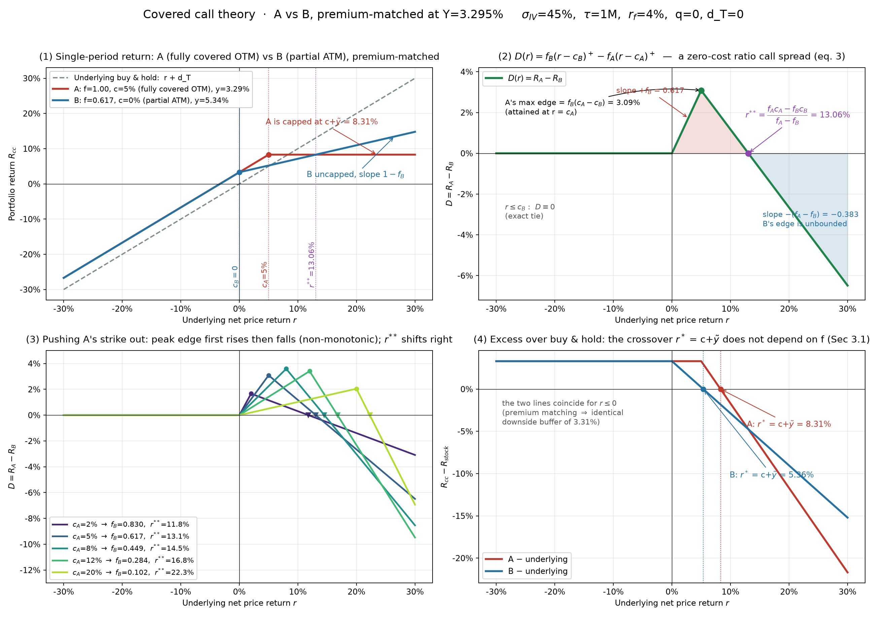

# Covered-Call Sweet Spot — theory and Mag7 empirics

Two ways to raise the same option income on a stock:

- **A:** sell an **OTM call on 100%** of the position.
- **B:** sell an **ATM call on part** of the position, sized so the premium matches A.

Which one wins, why, and where is the "sweet spot"? I first built this research during a 2026 index-research internship on options-based indices. This repo has my full theoretical derivation, an interactive model, and the empirical pipeline I ran across NVDA and the rest of the Mag7.



## Main results from the theory

Full derivation: [`theory/00_theory_derivation_en.md`](theory/00_theory_derivation_en.md). Every closed form is checked against a 4M-path Monte Carlo in `theory/00_theory_verify.py`.

1. **One formula covers every case.** $R_{cc}=(1-f)\,r+f\min(r,c)+f\,\tilde y+d_T$ covers OTM / ATM / ITM, full or partial overwrite, and multi-strike ladders.
2. **Covered call = equity beta + a cash-secured short put.** The overwrite ratio $f$ and the cap $c$ only decide how big a put you sell and how far out of the money.
3. **Alpha has an exact form.** For calls held to expiry, alpha $= Y e^{r_f\tau}\,(1-\rho(c))$, where $\rho(c)$ is the real-world expected payout per unit of premium.
4. **A vs B with matched premium is a pure ranking of $\rho$:** A beats B exactly when $\rho(c_A) < \rho(c_B)$. This holds without any distributional assumption. Skew, a fat right tail, and high drift can each flip the winner.
5. **The sweet spot is a range, not a point.** On the iso-premium curve the problem reduces to minimising $\rho(c)$, and $\rho$ is flat plus estimation noise.
6. **Compounding matters.** Variance-drag savings can make a zero-VRP overwrite win for high-vol, low-drift names and lose for high-drift ones. NVDA sits in the contested region, so the answer has to come from data.
7. **Negative gamma creates a timing leg** ("de-risk on rallies, re-risk on selloffs"). This matches AQR's uncompensated timing component. Any A↔B switching rule adds more timing, so it carries the burden of proof.

## Interactive model

- [`theory/ab_core.py`](theory/ab_core.py): Black-Scholes with a wing-skew tilt, an A/B solver, a scenario grid and self-checks.
- [`theory/AB_explorer.html`](theory/AB_explorer.html): slider explorer. Download it and open it in a browser; it mirrors `ab_core.py`, and `theory/qa/` checks that the JS and Python agree.
- Comparative statics for $\sigma$, $r_f$, borrow, tenor and skew: `theory/00_theory_comparative_statics*.md`.

## Empirical pipeline

The numbered scripts run per ticker (`TICKER=AAPL python 01_build_panel.py`):

| Step | Script | What it does |
|---|---|---|
| 01 | `01_build_panel.py` | Monthly panel of index rebalances: cap, call yield, realised return |
| 02 | `02_metrics_frontier.py` | Metrics by index and subperiod; income vs risk-adjusted-return frontier |
| 03 | `03_descriptive_stats.py` | Distribution, skewness, drawdown by structure |
| 04 | `04_premium_matched_comparison.py` | The core A-vs-B test at matched premium |
| 05 | `05_switch_signals.py` | Momentum-z A↔B switching rules |
| 06 | `06_delta_matched_benchmark.py` | AQR-style delta-matched benchmark |
| 06 | `06_skew_switch_*.py` | Realised-skew switching pilot and variants |
| 07 | `07_mag7_compare.py` | Cross-section across the seven names |
| 08 | `08_income_grid_full.py` | Full ticker × income-tier grid with paired bootstrap Sharpe vs buy-and-hold |

Also: `06_charts.py` (per-ticker chart pack) and `tools/` (audit and plotting helpers used by steps 05–08).

### Data and sample window

- **Index attribution reports** (one CSV per covered-call index, under `data/<TICKER>/`) from an index provider, covering monthly rebalances from 2008 (NVDA/AAPL/MSFT/AMZN) to 2026-07; GOOGL starts 2014-05, so the Mag7 cross-section (`07`, `08`) uses the common window 2014-05 → 2026-07. This data is licensed and I can't redistribute it, so `data/` and `results/` are not included and the empirical scripts will not run from this repo alone.
- **Risk-free rate**: 3-month T-bill (FRED `TB3MS`), downloaded once by `01_build_panel.py` and cached in `data/`.
- **Daily prices** for the exploratory skew-switch pilot (`06_skew_switch_pilot.py`) come from `yfinance` (auto-adjusted); that step is optional.

The theory pack is fully self-contained and runs as-is:

```bash
pip install -r requirements.txt
python theory/ab_core.py          # model self-check + scenario grid
python theory/00_theory_verify.py # closed form vs Monte Carlo (4M paths, ~10 s)
pytest -q                         # smoke tests for the pricing / A-B solver
```

## Limitations

- The closed forms assume European calls held to expiry and (for the toy numbers) lognormal returns; fat right tails and skew are handled by the distribution-free $\rho$ criterion, not by the Black-Scholes anchors.
- The wing-skew tilt in `ab_core.py` is a first-order sensitivity knob, not a fitted SVI/SSVI surface.
- Empirical results depend on provider index construction (monthly roll, premium-targeted strikes) and are not reproducible without that data.

## License

MIT
